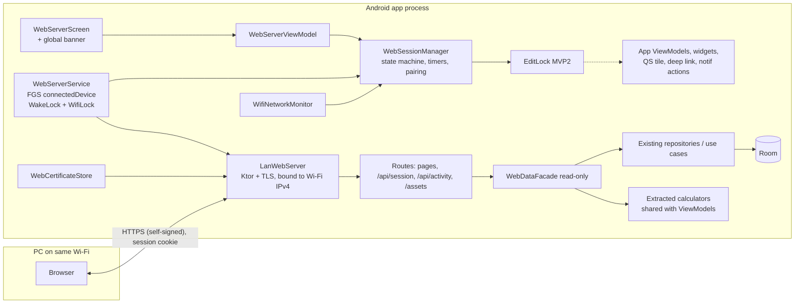
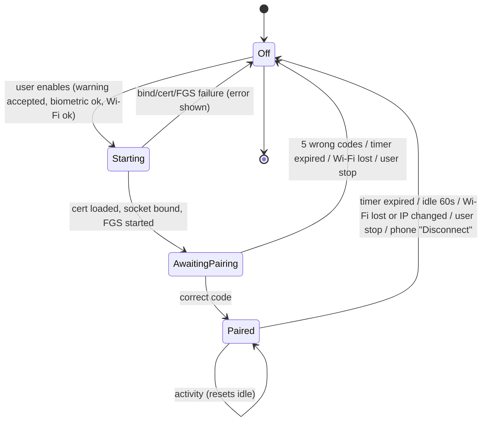
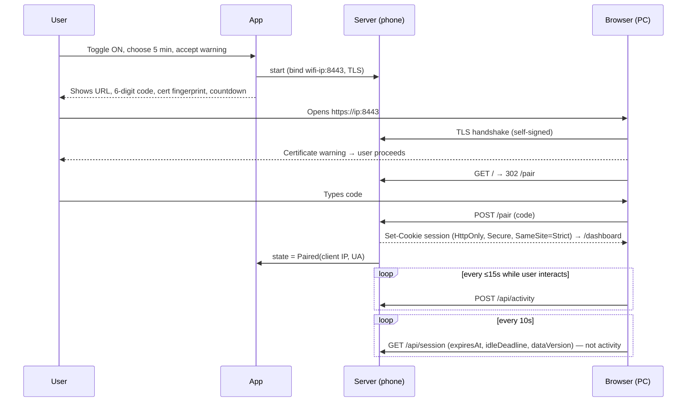

# PRD + Implementation Plan — Web Access over Wi‑Fi (LAN web server)

> **Status:** Proposal for maintainer review. Nothing here is implemented.
> **Audience:** Repo owner, and LLM coding agents that will implement it task by task.
> **Scope:** Android `app` module only. No iOS, no `shared`, no `pennywise-web` changes.

> [!IMPORTANT]
> **First action for the repo owner: validate and confirm Phase 0 (§12) before any other work.**
> The whole plan assumes an HTTPS server library and an on-device certificate approach that
> work on Android. Neither has been proven in this codebase yet. Run the Phase 0 spike, fill in
> the *Phase 0 results* table in §12, and mark it **Confirmed**. No Phase 1 or Phase 2 task
> may start until then.

### Owner decisions log

| Date | Topic | Decision |
|---|---|---|
| 2026-10-11 | Play Store friction | **Top priority.** Prefer the lowest-friction services, permissions and approaches that still meet the goal. Anything likely to trigger manual Play review is a **last resort** (§6.0). |
| 2026-10-11 | Wi‑Fi lock / latency | Higher latency while the phone screen is off is **accepted**. MVP2 adds a **loading animation** so the user knows an operation is in progress (§10.3, task U3). |
| 2026-10-11 | Self-signed certificate re-prompts | **Accepted.** Add a user-awareness note on the web access settings page (§9.2, §9.3). |
| 2026-10-11 | Pairing code + idle rule starting after pairing | **Accepted** as proposed (D2, D3). |
| 2026-10-11 | Server library + certificate on Android | **Owner must validate and confirm first** (Phase 0, §12). |

---

## 0. TL;DR

The phone runs a small **HTTPS server, started by the user and limited by a timer**, inside a
**`connectedDevice` foreground service**. A PC browser on the same Wi‑Fi opens
`https://<phone-ip>:8443`, accepts the self-signed certificate once, enters a **6‑digit
pairing code** shown in the app, and gets a **read-only** (MVP1) and later **read/write** (MVP2)
web UI. The UI is rendered **on the phone** from the same repositories and money utilities the app uses.
The server stops when the timer expires, when the paired browser has been idle for 60 s, when Wi‑Fi drops,
or when the user stops it.

Most of the requested design holds up, but **five points needed correcting**. See §2. Owner decisions are in the last column.

| # | Finding | Impact | Owner decision |
|---|---|---|---|
| 1 | **Every** foreground service type needs a Play Console declaration (description, impact statement, **video**) for apps targeting Android 14+. The app targets SDK 36. Without a foreground service, Android freezes a backgrounded app's process, so the "keep serving in the background" goal can't be met without one. | "No extra Play review" **cannot be met fully**. `connectedDevice` is the lowest-friction option because it is a pre-listed use case. `specialUse` is free-form and manually reviewed. | Minimise friction. Use `connectedDevice` with only normal permissions; manual-review paths are a last resort (§6.0). |
| 2 | `WIFI_MODE_FULL_HIGH_PERF` is **deprecated in API 34** and silently becomes `LOW_LATENCY`, which only works **screen on + app in foreground**. | On Android 14+ no Wi‑Fi lock keeps the radio out of power-save while the screen is off. Requests still work, with more latency. | Latency accepted. Loading animation in MVP2 (§10.3). |
| 3 | A self-signed certificate is **not accepted "once" forever**. Browsers scope the exception per host (IP:port), and Chrome expires it (currently about a week). | Re-prompts happen after an IP change, after a certificate reset, or after the browser's exception expires. Keep the certificate stable across sessions to minimise this. | Accepted. Explain it on the settings page (§9.3). |
| 4 | The spec has **no client authentication**. The certificate warning is not authentication, so anyone on the same Wi‑Fi could open the URL during the window. | **Added:** a 6-digit pairing code, a single paired browser, and rate limiting. Non-negotiable. | Accepted. |
| 5 | A 60 s idle rule that starts with the server would usually expire before the user has typed the URL, accepted the certificate and entered the code. | **Changed:** the idle rule starts **after pairing**. Before pairing, only the session timer applies. | Accepted. |

---

## 1. Goals / Non-goals

### Goals
- G1. Let a user browse their PennyWise data on a PC browser, served by their own phone over Wi‑Fi, with no cloud and no account.
- G2. Make it off by default, started manually, time-boxed and visibly running (in-app countdown, notification countdown, web countdown).
- G3. Render the same figures the app shows. Money stays currency-tagged and is never summed across currencies (CLAUDE.md Hard Constraints 1–2).
- G4. MVP1 is read-only. MVP2 adds edits from the web, and the app's own edit UI is locked while the server runs.
- G5. Ship in both the `standard` (Play) and `fdroid` flavors without new anti-features.

### Non-goals
- iOS support (its background model makes this unworkable; see the earlier feasibility notes).
- Access from outside the LAN, or any cloud relay, port forwarding or UPnP.
- Multiple simultaneous browsers.
- A full Settings clone on the web (rules, webhooks, AI model, backups stay phone-only).
- Service workers, PWA install, or offline web mode (they don't work reliably on self-signed origins).

---

## 2. Requirement validation

| Requirement (as written) | Verdict | Notes / evidence |
|---|---|---|
| Android only | ✅ Valid | The iOS app keeps its data in the `shared` KMP database (14 entities) while Android uses the `app` Room DB (22+ entities), so this would be a separate implementation anyway. |
| Require working Wi‑Fi | ✅ Valid, needs a definition | **Proposed:** `TRANSPORT_WIFI` is up and has an IPv4 address. Do **not** require `NET_CAPABILITY_VALIDATED`, because LAN-only/captive Wi‑Fi without internet is a valid use case. Tethering-host mode (phone is the hotspot) is excluded automatically because the phone isn't a Wi‑Fi client. See D5. |
| Bundled in the APK, served by the phone | ✅ Valid | Assets go in `app/src/main/assets/web/`. HTML is rendered server-side in Kotlin (§7). |
| Foreground service + persistent notification | ✅ Valid | Android 14+ lets users swipe the notification away. The service keeps running and remains visible in the system's foreground-services task manager. The in-app screen and banner are the primary indicator. |
| Keep socket open while app is backgrounded / screen off | ✅ Valid, with caveats | A foreground service keeps the process alive. Doze and OEM battery managers can still interfere, so test on device (§11). |
| Service type `connectedDevice` (validate) | ✅ **Validated as best fit** | Docs: "Interactions with external devices that require a Bluetooth, NFC, IR, USB, or **network connection**." Prerequisite: declare `FOREGROUND_SERVICE_CONNECTED_DEVICE` plus at least one of `CHANGE_NETWORK_STATE` / `CHANGE_WIFI_STATE` / `CHANGE_WIFI_MULTICAST_STATE` (all normal permissions, no runtime prompt). There is **no runtime limit** for this type (only `dataSync`, `mediaProcessing` and `shortService` have one). |
| No service needing extra Play review/approval | ⚠️ **Cannot be met fully**, minimised instead | All FGS types need the Play Console **App content → Foreground service** declaration (description, impact if deferred/interrupted, **video link**, use case). `connectedDevice` maps to the pre-set use case *"Continuous Data Transfer to an External Device"*. That is a lower-risk declaration than `specialUse`, but it still exists. Per the owner's decision, every capability in this plan is chosen for the lowest Play friction; see the **friction ledger in §6.0**. Escalation order if Play rejects: `dataSync` (sessions ≤ 60 min, far below its 6 h/24 h cap), then `specialUse` **only as a last resort** (D10). |
| Dedicated settings page with risks & safeguards | ✅ Valid | Pattern: `WebhooksScreen` (Settings sub-page). Copy is in §9.3. |
| `WifiLock` + `PARTIAL_WAKE_LOCK` | ✅ Valid, latency accepted | `PARTIAL_WAKE_LOCK` keeps the CPU serving requests. For the Wi‑Fi lock, use `WIFI_MODE_FULL_HIGH_PERF` on API 26–33 (works with the screen off) and `WIFI_MODE_FULL_LOW_LATENCY` on 34+ (screen on + foreground only). On 34+ with the screen off, expect more latency but working connections; **the owner accepts this**, and MVP2 adds a loading animation (§10.3). Both locks need a timeout and are released on stop. |
| MVP1 read-only, similar to app, PC-first | ✅ Valid | §8 page inventory. |
| MVP2 edits from the web | ✅ Valid | Must go through the existing use cases/repositories (rules engine, balances). |
| Concurrent edits disabled: server ON ⇒ app edits disabled | ✅ Valid, **scope expanded** | The lock must also cover **non-screen entry points**: home-screen widgets (`AddTransactionWidgetReceiver`), the Quick Settings tile (`QuickAddTileService`), the `pennywise://add` deep link, and notification actions (`ACTION_DELETE_TRANSACTION` / `ACTION_CONFIRM_TRANSACTION`), plus Settings import/restore/delete-all. **Background writers keep running** (SMS receiver, notification listener, recurring worker). They are system writes, not user edits, and the web UI must tolerate data changing underneath it. See D4 on whether to enforce this in MVP1. |
| Off by default | ✅ Valid | The state lives **in memory only**, so process death means Off. The service uses `START_NOT_STICKY` and never auto-restarts. |
| Warning when turning on | ✅ Valid | Copy in §9.3. Also require biometric/device credential if App Lock is enabled. |
| Self-signed HTTPS, accepted once | ⚠️ Valid, "once" is best effort (accepted) | See TL;DR #3. Persist the certificate across sessions and show its **SHA-256 fingerprint** in the app so the user can compare it in the browser's certificate viewer (defends against a MITM on first trust). Never send HSTS. The settings page carries a **certificate notice** explaining when the warning reappears (§9.3). |
| Manual toggle + timer, default 5 min | ✅ Valid | Proposed options: 5 (default) / 10 / 15 / 30 / 60 min. A phone-only "+5 min" button is optional (D6). |
| Countdown prominent in app and web | ✅ Valid | App: settings page, global banner, and a notification **chronometer countdown** (`setUsesChronometer(true)` + `setChronometerCountDown(true)` + `setWhen(expiresAt)`, API 24+). Web: sticky header countdown driven by server `expiresAt`. |
| Shutdown when timer is up | ✅ Valid | |
| Shutdown if no activity in last 1 min | ✅ Changed and accepted | The idle clock starts **after pairing** (TL;DR #5). "Activity" = authenticated user-initiated requests plus throttled input pings from the page. Status polling **does not** count (D2, D3). |

---

## 3. Decisions for the owner (defaults recommended)

| ID | Decision | Recommended default |
|---|---|---|
| D1 | Free or Pro (`standard`)? F-Droid is unlocked either way. | Owner's call. The webhook precedent is Pro via `EntitlementGate.isProEntitled`. |
| D2 | When does the 60 s idle rule start? | ✅ **Decided:** after successful pairing. |
| D3 | Idle length | ✅ **Decided:** **60 s**, as one constant. Input pings (mouse/keys/scroll) count as activity so reading with the mouse still works. Revisit after MVP1 feedback. |
| D4 | Enforce the app edit lock in MVP1 or MVP2? | **MVP2.** In MVP1 the web is read-only, so nothing concurrent needs protecting and locking only degrades app UX. Build the lock with the MVP2 write paths. |
| D5 | Definition of "working Wi‑Fi" | Wi‑Fi transport plus IPv4. Don't require internet validation. |
| D6 | Timer options / phone-side extend | 5/10/15/30/60 min. **Yes** to a phone-only "+5 min" (never from the web). |
| D7 | Certificate strategy | Decided by the **Phase 0 spike** (§6.3), **confirmed by the owner**. |
| D8 | Server engine | Decided by the **Phase 0 spike** (§6.2), **confirmed by the owner**. |
| D9 | Web UI strings | Put them in `strings.xml` from day one so Crowdin translates them, and render them server-side in the phone's locale. |
| D10 | FGS type escalation if Play rejects `connectedDevice` | ✅ **Decided (lowest friction first):** 1) `connectedDevice`; 2) `dataSync` (pre-listed use case; sessions far below the 6 h/24 h cap); 3) `specialUse` **last resort only** (free-form, manually reviewed). |
| D11 | Port | `8443`, falling back to `8444–8453` if busy, and shown in the UI. |

---

## 4. Architecture



### 4.1 Package layout (new code only)

```
app/src/main/java/com/pennywiseai/tracker/webaccess/
  session/   WebSessionManager.kt, WebSessionState.kt, PairingCode.kt, IdleTracker.kt
  net/       WifiNetworkMonitor.kt
  tls/       WebCertificateStore.kt
  server/    LanWebServer.kt, SecurityPlugins.kt, AuthPlugin.kt
  routes/    PairingRoutes.kt, SessionRoutes.kt, DashboardRoutes.kt, TransactionRoutes.kt, ...
  views/     Layout.kt, Components.kt, DashboardView.kt, ...   (kotlinx.html)
  data/      WebDataFacade.kt, WebDtos.kt
  service/   WebServerService.kt, WebServerNotification.kt
  editlock/  EditLock.kt                                         (MVP2)
app/src/main/java/com/pennywiseai/tracker/ui/screens/settings/webaccess/
  WebServerScreen.kt, WebServerViewModel.kt
app/src/main/assets/web/
  app.css, htmx.min.js (vendored, pinned, BSD-0), app.js (countdown + activity pings), icons
```

`WebSessionManager` is a Hilt `@Singleton` that holds `StateFlow<WebSessionState>`. It is the **single source of truth** for the UI, the service, the server and (MVP2) the EditLock. Keep it pure Kotlin with an injected `Clock`/`TimeSource` and `CoroutineScope` so it can be unit-tested with virtual time.

### 4.2 Session state machine



`Off` always means the socket is closed, locks are released, the service is stopped, the session cookie is invalidated, the pairing code is discarded, and (MVP2) the EditLock is released. Record the **reason** (`TimerExpired`, `Idle`, `WifiLost`, `UserStopped`, `TooManyAttempts`, `Error`) and show it in the app and on the web "session ended" page.

### 4.3 Pairing sequence



---

## 5. Security design

### 5.1 Threat model (LAN)

| Threat | Control |
|---|---|
| Another device on the same Wi‑Fi opens the URL | 6-digit pairing code shown **only in-app** (never in the notification or on the lock screen). Max **5 attempts per session**, then auto-stop. One paired browser at a time, and `POST /pair` returns 409 once paired. |
| Passive sniffing on Wi‑Fi | TLS 1.2+/1.3 only, with modern cipher defaults. |
| MITM on first trust | The app shows the certificate SHA-256 fingerprint so the user can compare it in the browser's certificate viewer. The certificate is persisted, so changes are suspicious. A "Reset certificate" button is available. |
| Session theft | 256-bit random token from `SecureRandom`, `HttpOnly; Secure; SameSite=Strict; Path=/`, no `Max-Age` (a session cookie). Invalidated on every Off transition. |
| DNS rebinding / cross-site requests | **Host header allow-list**: only `<wifi-ipv4>:<port>` is accepted, anything else gets 421/403. No CORS headers at all. MVP2: per-session CSRF token on every mutating request **and** an `Origin` check. |
| XSS via merchant names/notes (SMS-derived, untrusted) | kotlinx.html escapes by default, so never use `unsafe {}` with data. Strict CSP: `default-src 'self'; script-src 'self'; style-src 'self'; img-src 'self' data:; frame-ancestors 'none'; base-uri 'none'; form-action 'self'`. No inline scripts (configure htmx via `<meta name="htmx-config">`, `includeIndicatorStyles:false`). |
| Clickjacking | `frame-ancestors 'none'` + `X-Frame-Options: DENY`. |
| Data cached on a shared PC | `Cache-Control: no-store` on all data responses, `Referrer-Policy: no-referrer`, and a logout button that clears the cookie. The idle/timer stop limits exposure. |
| Exposure on other interfaces (cellular, VPN, hotspot) | **Bind only to the Wi‑Fi IPv4 address**, never `0.0.0.0`. Stop on IP change. |
| Resource exhaustion | Limit concurrent connections (e.g. 16), cap request bodies (64 KB), set read/write timeouts, cap page size (e.g. 200 rows). |
| Server outliving the user's intent | Hard timer cap (max 60 min), idle stop, `START_NOT_STICKY`, in-memory state (process death means Off), and Stop in the notification. |
| Phone unlocked by someone else starts the server | If App Lock is enabled, require `BiometricPrompt` (or device credential) before starting. Stopping never needs auth. |
| Logs leaking PII | Never log bodies, SMS text, merchants or amounts. Debug builds may log method, path template and status only. |

### 5.2 Things not to do
- Don't send HSTS: it would lock the user out of the IP-based origin after a certificate reset.
- Don't expose `/api/*` JSON beyond what the pages need. This is not a public API.
- Don't put the pairing code or session token in URLs, query strings, logs or the notification.
- Don't add the certificate, key or web prefs to `PennyWiseBackup` / `PreferencesSnapshot`. `allowBackup="false"` already covers Android backup. Store key material in `noBackupFilesDir` or the Android Keystore.

---

## 6. Android platform details

### 6.0 Play friction ledger (owner priority: lowest friction first)

Rule: use the lowest-friction option that still meets the goal. Anything that may trigger **manual Play review** or a **permission declaration form** is a last resort and needs explicit owner sign-off.

| Capability | Play friction | Decision |
|---|---|---|
| FGS type `connectedDevice` | FGS declaration with a **pre-listed** use case ("Continuous Data Transfer to an External Device"). Unavoidable for the background requirement. | ✅ **Use** |
| FGS type `dataSync` | Same declaration, but the use-case fit is weaker, so higher rejection risk. | ⏸ Fallback only if `connectedDevice` is rejected (D10) |
| FGS type `specialUse` | Free-form justification, **manually reviewed**. | ⛔ Last resort only |
| FGS type `shortService` | No type permission, but ~3 min hard limit with ANR on overrun. Can't meet the 5 min default. | ⛔ Not viable |
| No FGS (serve only while the app is open) | None | ⛔ Fails the background requirement. A cached app's process gets frozen. |
| `FOREGROUND_SERVICE`, `FOREGROUND_SERVICE_CONNECTED_DEVICE` | Normal permissions, no form | ✅ Use |
| `CHANGE_WIFI_STATE` (satisfies the `connectedDevice` prerequisite) | Normal permission, no form | ✅ Use (only one prerequisite permission needed) |
| `ACCESS_NETWORK_STATE` (Wi‑Fi detection, IP from `LinkProperties`) | Normal permission, no form | ✅ Use |
| `WAKE_LOCK` (wake lock + Wi‑Fi lock) | Normal permission, no form | ✅ Use |
| `ACCESS_WIFI_STATE` | Normal, but not needed | ❌ Don't request (minimise surface) |
| `CHANGE_WIFI_MULTICAST_STATE` / mDNS / NSD | Normal, but not needed | ❌ Don't request |
| Showing the Wi‑Fi network name (SSID) | Needs location (`ACCESS_FINE_LOCATION`) or `NEARBY_WIFI_DEVICES`, which are sensitive and draw scrutiny | ❌ **Don't show SSID**; show the IP only |
| `REQUEST_IGNORE_BATTERY_OPTIMIZATIONS` | Restricted by Play policy | ❌ Don't use. Link to `Settings.ACTION_IGNORE_BATTERY_OPTIMIZATION_SETTINGS` (no permission needed) |
| `SCHEDULE_EXACT_ALARM` / `USE_EXACT_ALARM` | Restricted / declaration | ❌ Don't use. Timers are coroutines inside the FGS. |
| `USE_FULL_SCREEN_INTENT` | Restricted / declaration | ❌ Don't use |
| `POST_NOTIFICATIONS`, `USE_BIOMETRIC` | Already declared by the app | ✅ Reuse |
| Data safety form | Possible update | Likely no change (data stays on the user's own devices); confirm before release (§13) |

### 6.1 Manifest additions (sketch)

```xml
<uses-permission android:name="android.permission.FOREGROUND_SERVICE" />
<uses-permission android:name="android.permission.FOREGROUND_SERVICE_CONNECTED_DEVICE" />
<uses-permission android:name="android.permission.CHANGE_WIFI_STATE" />
<uses-permission android:name="android.permission.ACCESS_NETWORK_STATE" />
<uses-permission android:name="android.permission.WAKE_LOCK" />

<service
    android:name=".webaccess.service.WebServerService"
    android:exported="false"
    android:foregroundServiceType="connectedDevice" />
```

All of these are **normal** permissions, so there is no runtime prompt and no Play permission form. Do not add anything outside this list without updating §6.0 and getting owner sign-off. `POST_NOTIFICATIONS` already exists. Request it when the user enables the feature, and continue if denied (the FGS still runs and the in-app countdown remains).

### 6.2 Server engine (Phase 0 decides)

| Option | Pros | Cons / risks |
|---|---|---|
| **A. Ktor 2.3.13 + Netty + `sslConnector`** (primary) | Same Ktor major as the app's existing client (avoids dependency conflicts). Same stack as `pennywise-web`. `testApplication` for route tests. HTML DSL plugin. | Netty on Android needs R8 keep rules and packaging excludes (`META-INF/io.netty.versions.properties`, `META-INF/INDEX.LIST`). APK size grows. Ktor's `buildKeyStore()` helper creates a **JKS** keystore, which **Android doesn't support**, so we must pass our own PKCS12/AndroidKeyStore `KeyStore`. |
| B. Ktor CIO | Small, pure Kotlin. | Ktor docs only document `sslConnector` with JVM engines, and CIO server TLS is not a supported path. **Rejected** for HTTPS. |
| C. NanoHTTPD + `makeSecure(SSLServerSocketFactory)` (fallback) | Tiny, proven on Android. | Unmaintained since 2016, so security posture is a concern. Hand-rolled routing, no HTML DSL. Use only if A fails. |

Constraint: the server must use the **same Ktor version as `libs.versions.toml` `ktorVersion` (2.3.13)**. Upgrading the app's Ktor client to 3.x is out of scope.

### 6.3 Certificate (Phase 0 decides)

| Option | How | Notes |
|---|---|---|
| **A. Android Keystore** (preferred if it works) | `KeyPairGenerator("EC", "AndroidKeyStore")` P-256, `PURPOSE_SIGN`, `setCertificateSubject`/`NotBefore`/`NotAfter`. The platform creates a self-signed certificate. Load with `KeyStore.getInstance("AndroidKeyStore")`. | No extra dependencies, and the private key never leaves secure hardware. **Risks:** no SAN extension, so the browser also reports a name mismatch (the click-through is the same). The TLS stack must accept a non-exportable key, and `KeyManagerFactory.init(ks, password)` may reject a password: pass `null`, or build the Netty `SslContext` manually. |
| B. BouncyCastle (`bcpkix-jdk18on`) | Generate an X.509 v3 certificate with SAN = Wi‑Fi IP and an EC P-256 key. Store a PKCS12 file in `noBackupFilesDir`, with its password randomly generated and wrapped by an Android Keystore AES key. | Proven approach with proper SAN. Adds dependency size (R8 shrinks it). The SAN would need regenerating when the IP changes, so **prefer a SAN-less stable certificate** to avoid re-prompts. |

Either way, **reuse the same certificate across sessions**, show the fingerprint, and offer "Reset certificate". Validity: 2 years. Chrome's 398-day limit applies to publicly trusted certificates, not user-bypassed ones (verify in the spike).

### 6.4 Service behaviour

- `ServiceCompat.startForeground(this, ID, notification, FOREGROUND_SERVICE_TYPE_CONNECTED_DEVICE)` within the start window. Start only from a user action in the foreground app (background-start restrictions).
- `onStartCommand` returns **`START_NOT_STICKY`**. Handle `ACTION_STOP` from the notification action.
- Notification channel `web_access` with `IMPORTANCE_LOW` (silent) and `VISIBILITY_PRIVATE`. The public version says only "PennyWise web access is on". Content: "Web access on · <ip>:<port>" with a countdown chronometer. Actions: **Stop**, Open app. **Never** show the pairing code.
- Locks:
  - `PowerManager.PARTIAL_WAKE_LOCK`, `acquire(timeoutMs = sessionMax + 60_000)`, released on Off.
  - `WifiManager.createWifiLock(if (SDK_INT < 34) WIFI_MODE_FULL_HIGH_PERF else WIFI_MODE_FULL_LOW_LATENCY, tag)`, with `setReferenceCounted(false)` and release on Off.
- `WifiNetworkMonitor`: `ConnectivityManager.registerNetworkCallback(NetworkRequest(TRANSPORT_WIFI))`. Expose `StateFlow<WifiStatus>` with the IPv4 address from `LinkProperties.linkAddresses`. On loss or IP change, stop with `WifiLost`.
- Process killed (Task Manager "Stop", OEM killer, crash): nothing persists, so on next launch the state is Off. That's correct and intended.

### 6.5 Doze / OEM reality check
- Foreground-service processes normally keep network access in Doze, but **verify on device**: `adb shell dumpsys deviceidle force-idle`, then drive requests from the PC for 10 min with the screen off.
- Known aggressive OEMs (Samsung, Xiaomi, OnePlus, Oppo/Vivo) may kill or throttle the service. The settings page links to the system battery-optimization list (`Settings.ACTION_IGNORE_BATTERY_OPTIMIZATION_SETTINGS`, no permission needed) with explanatory text. Don't prompt with `REQUEST_IGNORE_BATTERY_OPTIMIZATIONS`, because Play restricts that permission (§6.0).
- Sessions are short (≤ 60 min) and the wake lock is bounded, which keeps Play Android-vitals wake-lock metrics low.

---

## 7. Web UI technology

**Chosen: server-side rendered HTML (kotlinx.html via `ktor-server-html-builder`) + vendored htmx + one hand-written CSS file + a small `app.js`.** No Node toolchain.

Why:
1. **Money correctness**: figures are formatted in Kotlin with `CurrencyFormatter.formatCurrency(amount, currency)` / `formatByCurrency(...)` and totalled with `sumByCurrency`. No JavaScript money code that could drift (Hard Constraints 1–2).
2. **F-Droid**: no prebuilt JS bundles or Node build step. htmx is a single vendored, pinned file (0BSD license).
3. **LLM-friendly**: one language, and the same patterns as `pennywise-web` (`ui/*Views.kt`).
4. **Localization**: strings come from Android resources in the phone's locale (D9).

Charts: **inline SVG generated in Kotlin** (bar, line, donut). Accessible (`<title>`, `role="img"`, data table fallback) and needs no library.

### 7.1 PC-first UX checklist (apply to every page)
- Layout: left **sidebar nav** (Dashboard, Transactions, Analytics, Budgets, Accounts, Subscriptions), a top bar with a **sticky countdown pill**, and content max-width ~1280 px. Fluid from 1024 px. A narrow layout ≥ 768 px is enough (not a mobile target).
- **URL-addressable state**: filters, sort and page go in the query string, and `hx-push-url` makes back/forward and bookmarks work.
- **Keyboard**: logical tab order, visible `:focus-visible`, `/` focuses search, `j`/`k` move rows in the transaction table, `Esc` closes the detail drawer. All actions are reachable without a mouse.
- **Tables**: sticky header, sortable columns (server-side), right-aligned tabular numbers (`font-variant-numeric: tabular-nums`), server-side pagination, and an empty state.
- **Accessibility**: semantic landmarks (`header/nav/main`), labelled form controls, WCAG AA contrast in light and dark, `prefers-color-scheme` (mirrors the app's Material 3 palette from `ui/theme/Color.kt`), `prefers-reduced-motion`.
- **Feedback**: inline error states and a "session ended" full-page state. The full loading animation is an **MVP2** item (§10.3, U3). MVP1 only needs to avoid double submits (disable the triggering control while a request is in flight).
- **Privacy**: respect the app's `isBalanceHidden` preference (mask balances, with a click-to-reveal per page view), and show `unifiedCurrencyMode` / `displayCurrency` exactly as the app does.
- **No** service workers, `localStorage` for data, third-party fonts/CDNs, analytics, or `eval`.
- Print stylesheet for transaction lists (nice-to-have).

### 7.2 Countdown & idle UX (web)
- `GET /api/session` → `{ "expiresAt": epochMs, "serverNow": epochMs, "idleDeadline": epochMs|null, "dataVersion": long }` every 10 s. Computing the clock offset from `serverNow` makes the countdown immune to PC clock skew.
- `app.js` sends `POST /api/activity` **at most every 15 s** while there is `keydown`, `pointerdown`, `wheel` or `scroll` input and the tab is visible.
- At **idle − 15 s** show a "Still there?" toast with a button (clicking counts as activity). At **expiry − 60 s** the countdown pill turns warning-coloured.
- When `dataVersion` changes (e.g. a new SMS transaction was recorded), show "New data — Refresh". No auto-reload while the user is reading.
- On 401/410 from any request, go to `/ended?reason=…`.

---

## 8. MVP1 scope (read-only)

| Page | Route | Content | Data source (reuse; never re-implement figures) |
|---|---|---|---|
| Pair | `GET/POST /pair` | Code entry, attempts remaining | `WebSessionManager` |
| Dashboard | `/` | This-period income / expense / net **per currency** (or unified when enabled), account balances, active budget progress, recent 10 transactions, upcoming subscriptions | Calculators **extracted** from `HomeViewModel` (§8.1), `AccountBalanceRepository.getAllLatestBalances()`, `BudgetGroupRepository.getGroupSpending*`, `SubscriptionRepository.getUpcomingSubscriptions()` |
| Transactions | `/transactions` | Filters: date range presets + custom, type, category, account, currency, text search. Sortable, paged table | **New paged DAO query** (read-only, **no schema change, no migration**) |
| Transaction detail | `/transactions/{id}` (drawer via htmx) | All fields, splits, tags, linked loan/subscription, original SMS body (behind a "Show SMS" toggle) | `TransactionRepository.getTransactionById` + related repos |
| Analytics | `/analytics` | Period selector, type filter, currency selector (mirrors app rules), category breakdown (donut + table), trend (bar/line) | Calculators **extracted** from `AnalyticsViewModel` |
| Budgets | `/budgets` | Active groups, progress, per-category spend | `BudgetGroupRepository` |
| Accounts | `/accounts`, `/accounts/{bank}/{last4}` | Latest balances, balance history chart | `AccountBalanceRepository` |
| Subscriptions | `/subscriptions` | Active / ended, next payment | `SubscriptionRepository` |
| Session | `/api/session`, `/api/activity`, `POST /logout`, `/ended` | §7.2 | `WebSessionManager` |
| Assets | `/assets/*` | CSS/JS/icons from `assets/web/` with `Cache-Control: max-age` + a content hash in the file name | AssetManager |

Loans, Rules, Recurring, Groups, Webhooks and Settings are **out of MVP1**.

### 8.1 Parity rule (important)
`HomeViewModel` (~1.7k lines), `TransactionsViewModel` (~1.7k) and `AnalyticsViewModel` (~850) contain calculation logic. **Do not copy it.** For every figure the web shows:
1. Extract the calculation into a pure, injectable class under `domain/` (e.g. `PeriodSummaryCalculator`, `CategoryBreakdownCalculator`). Inputs are entities plus preferences; outputs are currency-keyed `Map<String, Money>` / DTOs.
2. Make the ViewModel call the extracted class. This is a behaviour-preserving refactor, with existing tests still passing.
3. Have the web facade call the same class.
4. Add a unit test proving the ViewModel path and the facade path give identical output for a mixed-currency fixture.

### 8.2 Concurrency with background writers
Page data is read at request time inside a coroutine on `Dispatchers.IO`, using `Flow.first()` for flow-returning repos. `dataVersion` = max `updated_at` across transactions (one cheap query) is used for the "New data" hint.

---

## 9. App-side UI

### 9.1 Entry points
- Settings → new row **"Web access (beta)"**, using the same pattern as `onNavigateToWebhooks` in `SettingsScreen.kt`. Gate per D1.
- A **global banner** (app scaffold level, all screens) while the state is not Off: "Web access on · 03:42 left · Stop". In MVP2 the banner adds "Editing paused on this phone".

### 9.2 `WebServerScreen` states
| State | Shows |
|---|---|
| Off, Wi‑Fi OK | Explainer, timer picker (default 5 min), "Turn on" button, "Risks & safeguards" card, **certificate notice**, certificate fingerprint + "Reset certificate" |
| Off, no Wi‑Fi | Disabled toggle, "Connect to Wi‑Fi to use web access" with a button to open Wi‑Fi settings |
| Starting | Progress |
| AwaitingPairing | **Large** URL `https://192.168.x.y:8443`, **large** 6-digit code, fingerprint, **certificate notice** (compact form), countdown, Stop |
| Paired | "Connected: <browser> from <ip>", countdown, idle indicator, **Disconnect**, Stop, optional "+5 min" (D6) |
| Ended | Reason ("Stopped after 1 min of inactivity", "Wi‑Fi disconnected", etc.) |

Follow `PennyWiseScaffold`, Material 3, the 8 dp grid, and check light and dark themes (`docs/design.md`).

### 9.3 Copy (draft — move into `strings.xml`)

**Enable warning dialog**
> **Turn on web access?**
> Your financial data will be available to a browser on this Wi‑Fi network until the timer ends.
> • Only use this on a network you trust (home, not public/café Wi‑Fi).
> • You'll see a certificate warning in your browser. This is expected. Check the fingerprint matches the one shown here.
> • Anyone who sees the pairing code on your screen could connect. Keep it private.
> • Web access stops automatically after the timer, after 1 minute of inactivity, or if Wi‑Fi disconnects.
> [Cancel] [Turn on]

**Risks & safeguards card**
- *Who can connect:* Only one browser, and only after entering the code shown on this phone.
- *What's shared:* Your transactions, balances, budgets and subscriptions are sent only to that browser over an encrypted connection. Nothing goes to the internet or to PennyWise.
- *Public Wi‑Fi:* Don't use it there. Other people on the network can see that your phone is offering a service.
- *Shared computers:* Log out and close the tab when done. PennyWise tells the browser not to store pages, but extensions or screen recorders on that PC could still see them.
- *Battery:* While on, your phone stays partly awake. Short timers are best.
- *Certificate warning:* Expected. It appears again if your phone's IP address changes or after you reset the certificate.

**Certificate notice (always visible on the web access settings page; compact form while waiting for pairing)**
> **About the browser security warning**
> Your browser will show a warning such as "Your connection is not private" the first time you connect. This is expected: your phone uses its own security certificate instead of one issued by an internet authority. Your connection is still encrypted.
> Before you continue, compare the fingerprint in your browser's certificate details with the one shown here: **AB:CD:…**.
> You may see this warning again when:
> • your phone's IP address on this Wi‑Fi changes,
> • you tap **Reset certificate**,
> • your browser forgets your earlier choice (some browsers do this after about a week),
> • you use a different browser or computer.
> If the fingerprint ever doesn't match, don't continue. Turn off web access.

*Compact form:* "Expect a browser security warning. Check the fingerprint matches **AB:CD:…** before continuing."

---

## 10. MVP2 (edits from the web + app edit lock)

### 10.1 EditLock
- `interface EditLock { val isLocked: StateFlow<Boolean> }`, backed by `WebSessionManager.state != Off`. It is **in memory only**, so process death unlocks.
- Touchpoints to gate (from the current codebase, verify each when implementing):
  - ViewModels with user writes: `AddViewModel`, `TransactionDetailViewModel`, `TransactionsViewModel` (bulk actions), `ManageAccountsViewModel`, account detail, `CategoriesViewModel`, `SubscriptionsViewModel`, `BudgetGroupsViewModel`, `BudgetGroupEditViewModel`, `LoansViewModel`, `LoanDetailViewModel`, `RecurringTransactionsViewModel`, `TransactionGroupsViewModel`, `RulesViewModel`, `SettingsViewModel` (import/restore/delete-all), onboarding (not reachable while on, but assert).
  - Non-screen entry points: `AddTransactionWidgetReceiver` + the other widgets' tap actions, `QuickAddTileService`, the `pennywise://add` deep link in `MainActivity`, and `NotificationActionReceiver` (`ACTION_DELETE_TRANSACTION`, `ACTION_CONFIRM_TRANSACTION`). While locked these open the app with the banner instead of writing.
  - UI: disable FABs and edit/delete buttons, and show the banner. Writes rejected at the ViewModel layer surface a snackbar: "Editing is paused while web access is on".
- **Not gated:** SMS receiver, notification listener, `RecurringTransactionWorker`, `BankNotificationRetryWorker`, webhook sync, scheduled backup. These are system writes.

### 10.2 Web write paths
- Every mutating route needs: a valid session, the **CSRF token** (hidden field / `hx-headers`), an `Origin` equal to the server origin, and `Content-Type: application/x-www-form-urlencoded`.
- Writes go **only** through existing use cases/repositories: `AddTransactionUseCase`, `DeleteTransactionUseCase` / `RestoreTransactionUseCase` (offer **Undo**), `TransactionRepository` update paths, and category/budget repositories. The rules engine and balance side effects then behave exactly as in the app.
- Validate input server-side: amount as `BigDecimal` with currency scale, currency from the known list, dates parsed strictly, string length caps. Never trust the client.
- First write features (in priority order): change category / merchant / note on a transaction, then bulk re-categorise, delete + undo, add a manual transaction, then edit budgets. Re-prioritise from MVP1 feedback.

### 10.3 Loading animation (owner request)
The phone can respond slowly while its screen is off (Wi‑Fi power-save on Android 14+, accepted by the owner). Keep the user informed:
- **Scope:** every htmx request (navigation, filters, pagination, detail drawer) and every write.
- **Delay before showing:** ~300 ms, so fast responses don't flicker.
- **Patterns:** a thin indeterminate **top progress bar** for page/region loads; a **spinner inside the triggering button** for writes, with the button disabled until the response arrives; **skeleton rows** when a table region is reloading.
- **Slow-response hint:** after ~5 s, add "Waiting for your phone… (this can take longer when its screen is off)". After ~15 s, offer **Retry**; never auto-repeat writes.
- **Accessibility:** `aria-busy="true"` on the loading region, a polite `aria-live` status message, and `prefers-reduced-motion` swaps animation for a static "Loading…" label.
- **Implementation:** CSS-only animation driven by htmx's `htmx-request` class / `hx-indicator`, timers in `app.js`. No inline styles or scripts (CSP), no new libraries.

---

## 11. Testing & verification

| Layer | What | How |
|---|---|---|
| Unit (JVM) | `WebSessionManager` transitions, timer expiry, idle-after-pairing, 5-attempt lockout, extend, reason codes | `kotlinx-coroutines-test` virtual time, MockK |
| Unit | Pairing code generation (uniform, 6 digits, `SecureRandom`), constant-time compare | JUnit4 |
| Unit | Calculator parity (§8.1) incl. **mixed-currency** fixtures; no cross-currency sums | JUnit4; extends `CurrencyFormatterTest` style |
| Route (JVM) | Host allow-list, auth redirect, cookie flags, security headers/CSP, 409 on second pair, `/api/session` shape, `no-store`, MVP2 CSRF/Origin rejects | `ktor-server-test-host` 2.3.13 `testApplication` with fake facade |
| Instrumented | Service starts as `connectedDevice`, stops on `ACTION_STOP`, `START_NOT_STICKY`, locks released | `androidTest` on emulator |
| Manual device matrix | Pixel API 34 & 36, one Samsung, one Xiaomi/Redmi, API 26 emulator · Chrome, Edge, Firefox (Win/macOS), Safari (macOS) | Checklist below |

**Manual checklist (each MVP)**
1. Enable → warning → biometric (if App Lock on) → URL/code shown. Notification shows the countdown and **no code**.
2. Browser: certificate warning → proceed → pair. Wrong code ×5 → server stops.
3. A second browser cannot pair while paired.
4. Screen off for 10 min (timer 15) with requests every 30 s from the PC: all succeed. Repeat after `adb shell dumpsys deviceidle force-idle`.
5. Idle 60 s after pairing → stops. Before pairing, idle doesn't stop it.
6. Timer expiry → web shows `/ended`, app shows the reason.
7. Turn Wi‑Fi off/on, or switch network → stops with `WifiLost`.
8. Kill the app from Recents / force stop → nothing restarts. Reopen → Off.
9. Light/dark on the web and app. Keyboard-only navigation across all pages.
10. Mixed-currency data: no combined totals anywhere unless unified mode is on, and then they match the app exactly.
11. MVP2: app edit UI disabled, widgets/tile/deep link/notification actions blocked, SMS still ingested and shown after "Refresh".
12. MVP2: with the phone screen off, the loading animation and slow-response hint appear, writes can't be double-submitted, and reduced-motion shows the static label.
13. Settings page shows the certificate notice. Its fingerprint matches the one in each browser's certificate viewer.

**Gate:** `./init.sh app` for every task. CI's App Compile job also assembles a debug APK. Because Netty/BC are R8-sensitive, also build a release variant locally once per dependency change (e.g. `./gradlew :app:assembleFdroidRelease`, which is unsigned) and smoke-test it on a device.

---

## 12. Implementation plan (LLM-sized tasks)

Each task is one PR / one agent session. **S/M/L** = relative size. Run `./init.sh app` before marking a task done.

### Phase 0 — Validate & confirm (throwaway branch, do **not** merge)

> **Owner gate.** This phase answers one question: *do the chosen HTTPS server library and
> certificate approach work reliably on Android?* The repo owner (or someone they nominate)
> runs it, records the results below, and marks the gate **Confirmed** or **Rejected**.
> Phase 1 and Phase 2 are blocked until it is **Confirmed**.

| ID | Task | Exit criteria |
|---|---|---|
| P0.1 | Minimal FGS (`connectedDevice`, with only the §6.1 permissions) + Ktor 2.3.13 Netty `sslConnector` serving "hello" on `wifiIp:8443`. Try certificate option A (AndroidKeyStore EC), then B (BC PKCS12). | HTTPS works from a PC browser on an API 26 emulator, API 36 emulator and one physical device. The FGS starts with no `SecurityException` or `MissingForegroundServiceTypeException`. Record which certificate option works. |
| P0.2 | Release build with R8. | Builds and runs. Record the keep rules needed and the **APK size delta** (owner sets a budget, suggested ≤ 5 MB). |
| P0.3 | Reliability: screen-off + `force-idle` test, 10 min, `curl -k` loop from the PC; plus 20 start/stop cycles and a Wi‑Fi off/on cycle. | ≥ 95 % of requests succeed (higher latency with the screen off is acceptable). Every start/stop cycle cleanly binds and releases the port. Record Wi‑Fi lock behaviour on API 34+. |
| P0.4 | Browsers: Chrome, Edge, Firefox, Safari can proceed past the certificate warning and load the page. | Click-through works in all four. Record any browser that refuses (e.g. due to the missing SAN in option A). |
| P0.5 | Fill in the *Phase 0 results* table below and request owner confirmation. | Owner marks **Confirmed** (D7/D8 recorded) or **Rejected**. If no engine/certificate combination passes, stop and revisit the approach with the owner before doing anything else. |

**Phase 0 results (fill in, then owner confirms)**

| Item | Result |
|---|---|
| Server engine that passed (D8) | _tbd_ |
| Certificate option that passed (D7) | _tbd_ |
| Devices / API levels tested | _tbd_ |
| Browsers tested | _tbd_ |
| Screen-off success rate / p95 latency | _tbd_ |
| Release build OK + R8 keep rules | _tbd_ |
| APK size delta (standard / fdroid) | _tbd_ |
| Known issues | _tbd_ |
| **Owner gate** | ☐ Confirmed ☐ Rejected — name, date |

### Phase 1 — MVP1 (read-only)
| ID | Size | Task | Key files | Acceptance |
|---|---|---|---|---|
| T1 | S | Add deps to `gradle/libs.versions.toml` (`ktor-server-core`, `-netty`, `-html-builder`, `-status-pages`, `-test-host` (test), BC if chosen), packaging excludes, R8 keep rules from P0.2. | `libs.versions.toml`, `app/build.gradle.kts`, `proguard-rules.pro` | `./init.sh app` passes. Release build runs. |
| T2 | M | `WebSessionManager` + `WebSessionState` + `PairingCode` + `IdleTracker` (pure Kotlin, Hilt singleton). | `webaccess/session/*` | Unit tests for all transitions in §4.2 pass with virtual time. |
| T3 | S | `WifiNetworkMonitor`. | `webaccess/net/*` | Emits IPv4 on connect, `null` on loss. Unit-tested via a fake. |
| T4 | M | `WebCertificateStore` (chosen option): create-or-load, fingerprint, reset. | `webaccess/tls/*` | Same fingerprint across restarts. Reset changes it. Key material not in any backup. |
| T5 | L | `LanWebServer` + plugins: bind ip:port with fallback, TLS, security headers/CSP, Host allow-list, session auth, StatusPages, limits. Routes: `/pair`, `/api/session`, `/api/activity`, `/logout`, `/ended`, `/assets/*`. | `webaccess/server/*`, `webaccess/routes/*` | `testApplication` tests from §11 pass. |
| T6 | M | `WebServerService` + notification (chronometer countdown, Stop action, private visibility) + locks + manifest. | `webaccess/service/*`, `AndroidManifest.xml` | Instrumented start/stop test. Manual checklist items 1, 4, 7, 8. |
| T7 | M | Settings row + `WebServerScreen` + `WebServerViewModel` + warning dialog + biometric gate + risks card + global banner + strings. | `ui/screens/settings/webaccess/*`, `SettingsScreen.kt`, nav wiring, `strings.xml` | Light/dark screenshots. Gating per D1. Checklist item 1. |
| T8 | M | Web shell: `Layout.kt` (sidebar, countdown pill), `app.css` (Material palette, light/dark), vendored `htmx.min.js`, `app.js` (countdown, activity pings, idle toast, ended redirect), pair page, ended page. | `webaccess/views/*`, `assets/web/*` | Keyboard-navigable. CSP has no violations in the browser console. |
| T9 | L | Parity extraction (§8.1) for the dashboard + analytics figures, plus `WebDataFacade` + DTOs. | `domain/...Calculator.kt`, ViewModels (refactor only), `webaccess/data/*` | Existing tests pass. New parity tests (mixed currency) pass. No behaviour change in the app. |
| T10 | M | Dashboard page. | `DashboardRoutes.kt`, `DashboardView.kt` | Figures match the app on a test dataset (manual + parity tests). |
| T11 | L | Transactions list (paged DAO query, filters, sort, search, URL state) + detail drawer. | DAO (query only), `TransactionRoutes.kt`, views | 10k-row dataset pages in < 500 ms on a mid-range device. No schema change. |
| T12 | M | Budgets, Accounts (+ history SVG), Subscriptions pages. | routes/views | Match the app. |
| T13 | M | Analytics page with SVG charts + table fallback. | routes/views, `Charts.kt` | Matches the app for each period/type/currency combination tested. |
| T14 | M | Hardening + docs: run the full §11 checklist; write `docs/web-access.md` (user + dev); add a row to the CLAUDE.md topic table; update `PRIVACY.md`; prepare the Play Console FGS declaration text + video script (§13). | docs | Owner review. |

### Phase 2 — MVP2 (edits)
| ID | Size | Task | Acceptance |
|---|---|---|---|
| U1 | L | `EditLock` + gating of all touchpoints in §10.1 + banner text. | Unit tests per ViewModel guard. Manual checklist item 11. |
| U2 | S | CSRF token + Origin check plugin for mutating routes. | Route tests reject a missing/invalid token or a foreign Origin. |
| U3 | M | **Loading animation** (§10.3): top progress bar, in-button spinner for writes, skeleton rows, slow-response hint + Retry, reduced-motion fallback. | No flicker under 300 ms. Slow hint appears with the phone screen off. Writes can't be double-submitted. `aria-busy`/`aria-live` present. CSP has no violations. |
| U4 | M | Edit category/merchant/note (single + bulk) via existing repos. | Rules/balances behave exactly as when edited in the app. |
| U5 | M | Delete + Undo (`DeleteTransactionUseCase` / `RestoreTransactionUseCase`). | Undo restores everything, including splits/tags. |
| U6 | M | Add manual transaction via `AddTransactionUseCase` (currency required, `BigDecimal` validation). | Server-side validation tests. |
| U7 | M | UX improvements from MVP1 feedback (shortcuts, saved filters, etc.). | Owner-prioritised. |

---

## 13. Store & distribution checklist

- **Play friction check:** before release, diff the merged manifest's permissions against §6.0. Any new permission or FGS type needs owner sign-off.
- **Play Console → App content → Foreground service:** type `connectedDevice`, use case *"Continuous Data Transfer to an External Device"*. Use the pre-listed use case, not a free-text one.
  - *Description:* "User-initiated, time-limited web access: the user turns on a local HTTPS server so their own computer's browser on the same Wi‑Fi network can view (and, in a later version, edit) their PennyWise data. The service runs only while the user-selected timer (5–60 min) is active and stops after 1 minute of inactivity."
  - *Impact if deferred:* "The user's browser cannot connect until the service starts; the user is waiting on the settings screen."
  - *Impact if interrupted:* "The browser session ends; the user must turn web access on again."
  - *Video:* Settings → Web access → Turn on → warning → browser connects → pair → dashboard → Stop from the notification.
- **Data safety form:** review it. Data goes only to the user's own browser on the user's network at their request, and is not sent to the developer or third parties. Likely no change, but **confirm with current Play guidance**.
- **PRIVACY.md:** add a "Web access" section.
- **F-Droid:** all new deps are FOSS (Ktor/Netty Apache-2.0, BouncyCastle MIT-style, htmx 0BSD). No network calls to third parties, so no new anti-features expected. The vendored htmx file should be the unmodified upstream release with its version noted.
- **Release:** never hand-edit versions/changelogs. `scripts/release.sh` owns them (CLAUDE.md Hard Constraint 5).

---

## 14. Risks register

| Risk | Likelihood | Mitigation |
|---|---|---|
| Netty/TLS doesn't work on some Android versions | Medium | Phase 0 owner gate; fallback engine C |
| AndroidKeyStore key unusable by the TLS stack | Medium | Certificate option B |
| Play rejects the `connectedDevice` declaration | Low–Medium | Clear video/description; escalate per D10 (`dataSync`, then `specialUse` last resort) |
| A later change adds a permission that draws Play scrutiny | Medium | §6.0 ledger + pre-release manifest diff (§13) |
| Slow responses with the screen off confuse users | Medium (accepted) | Loading animation + slow-response hint (§10.3) |
| OEM kills the service with the screen off | Medium | Docs + battery-settings deep link; short sessions; checklist item 4 |
| Web figures differ from the app | Medium | Parity extraction + tests (§8.1) |
| APK size growth | Medium | Measure in P0.2; R8; owner budget |
| Users on public Wi‑Fi | Medium | Warning copy; pairing code; short timers |
| Re-prompting certificate warnings annoy users | High (by design, accepted) | Stable certificate; certificate notice on the settings page (§9.3) |
| Edit lock misses an entry point (MVP2) | Medium | Explicit touchpoint list; grep for write use cases; manual checklist |

---

## 15. Rules for LLM coding agents (paste into each task prompt)

```
You are implementing task <ID> from docs/prd-web-access.md in the PennyWise repo.
Before coding: read CLAUDE.md, this PRD's sections <list>, docs/architecture.md,
docs/state-management.md, and docs/design.md (UI tasks).

Hard rules:
- Do not start any Phase 1 or Phase 2 task unless the Phase 0 owner gate in
  section 12 is marked Confirmed. If it isn't, stop and say so.
- Play friction: only use the permissions and FGS type listed in section 6.0.
  Never add a permission, FGS type, or restricted API without owner sign-off.
- Money: format with CurrencyFormatter.formatCurrency(amount, currencyCode) or
  formatByCurrency(...); total with sumByCurrency(...). Never sum across currencies.
  No money math or formatting in JavaScript.
- No PII in code, comments, tests, fixtures, or logs. Use synthetic data.
- Do not change Room entities or add migrations. New DAO *queries* are allowed.
- Do not add anything to backup models (BackupModels.kt / PreferencesSnapshot).
- Do not touch versionCode/versionName or changelogs.
- Web output: kotlinx.html only, never `unsafe {}` with data; no inline <script>
  or style attributes (CSP). No third-party CDNs.
- Server binds only to the Wi-Fi IPv4 address; never 0.0.0.0.
- Keep the Ktor server at the same version as libs.versions.toml `ktorVersion`.
- Writes (MVP2) go through existing use cases/repositories only.
- Comments only where code can't speak for itself; one short line.

Done means: task acceptance criteria met, new tests added and passing,
`./init.sh app` passes, and (for UI) light + dark checked.
Report: files changed, tests added, anything deferred and why.
```

---

## 16. References (checked 2026-10-11)

- Android FGS types (connectedDevice prerequisites; Play declaration note): <https://developer.android.com/develop/background-work/services/fgs/service-types>
- FGS timeouts (only dataSync/mediaProcessing/shortService are time-limited): <https://developer.android.com/develop/background-work/services/fgs/timeout>
- Play Console FGS declaration requirements (description, impact, video, use case table): <https://support.google.com/googleplay/android-developer/answer/13392821>
- `WifiManager` lock modes (HIGH_PERF deprecated API 34 → LOW_LATENCY restrictions): <https://developer.android.com/reference/android/net/wifi/WifiManager#WIFI_MODE_FULL_HIGH_PERF>
- `WifiManager.WifiLock` (requires `WAKE_LOCK`): <https://developer.android.com/reference/android/net/wifi/WifiManager.WifiLock>
- Ktor engines & SSL (`sslConnector`, JKS-based helpers): <https://ktor.io/docs/server-engines.html>, <https://ktor.io/docs/server-ssl.html>
